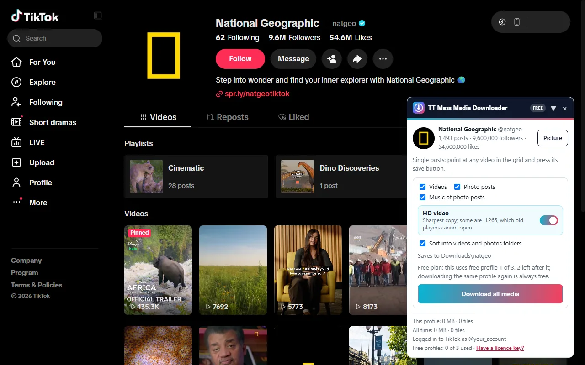
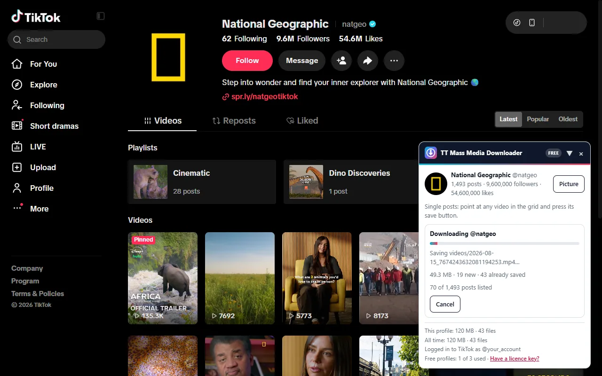
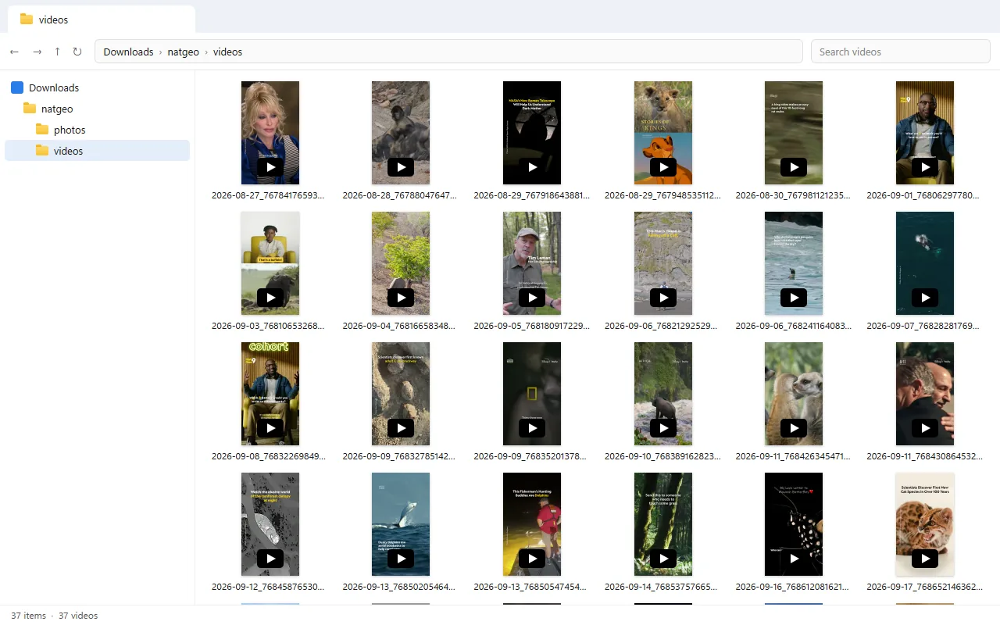

# TT Mass Media Downloader: a TikTok profile downloader for Chrome

A browser extension that saves every video and photo post of a TikTok profile in one click, in the best quality TikTok serves, without the watermark, into one folder. For Chrome, Brave and Edge.

**[Add to Chrome](https://chromewebstore.google.com/detail/tt-mass-media-downloader/odeckbdplgkcgnooheajljinmbjalebm)** · [Website](https://novabyteworks.com/tiktok) · [Guides](https://novabyteworks.com/guides) · [Pricing](https://novabyteworks.com/tiktok#pricing) · [Privacy](https://novabyteworks.com/privacy-tiktok)



> **This repository is for bug reports, feature requests and release notes.** The extension is not open source, so its code is not here. It is free for three profiles and for every single post; unlimited profiles need a paid licence.

## What it saves

- **A whole profile**: every video and photo post, newest first. Choose videos, photo posts or both.
- **A single post**: press Save on its page, or point at any video in a grid and press the round save button. Always free, no login needed.
- **Best quality, no watermark**: the sharpest copy TikTok has of each video, and every picture of a photo post at full size
- **The music of photo posts**, saved next to the pictures, if you want it
- **Only what is new**: stop at any time; the next run skips what you already have

## How to use it

1. Log in to TikTok as usual and open any profile. The panel appears in the corner.
2. Choose what to save: videos, photo posts, their music, HD video, and whether to sort them into folders.
3. Press **Download all media**. The files land in your Downloads folder, in a folder named after the profile. Switch tabs or minimise the browser; it keeps going.



Watch it: [the 40-second demo](https://youtu.be/N9G1nlszSjM).

## Real files with real names

Videos go into one folder and photo posts into another, each file named after the post's date and id:

```
Downloads\<profile>\
  profile.jpg
  videos\<date>_<video id>.mp4
  photos\<date>_<post id>_01.jpg, _02.jpg, …, _music.mp3
```



## My Library

Everything you saved, in one gallery on your own computer: collections, favourites, tags, duplicates, two pictures side by side, and a timed slideshow for drawing practice. Find things by profile name or tag. On paid plans it adds smart search (describe a picture, like "red dress" or "golden hour"), which runs on your computer.

## Free and paid

| | Free | Paid |
|---|---|---|
| Whole profiles | Three for each TikTok account | Unlimited |
| Single posts | Always | Always |
| My Library | Yes | Plus smart search |

Paid is a one-time lifetime licence or a monthly plan: see [pricing](https://novabyteworks.com/tiktok#pricing).

## Questions

**Do I need a TikTok account?** For single posts, no. For whole profiles you need to be logged in to TikTok in the browser, because the three free profiles are counted for each TikTok account. Your password and cookies never leave the browser.

**Is it safe for my account?** The extension asks TikTok for the profile's posts the way the page itself does, at the site's own pace, and downloads the files from TikTok's own servers. If TikTok asks you to verify you are human, solve it on the page and press Run again.

**Why will a video not open in my player?** The sharpest copy of a video is often H.265, which some old players cannot open. Switch HD video off in the panel to get a copy that plays everywhere.

**What does it send to you?** Your TikTok account id and username and the names of the profiles you start downloading, to count the free profiles and run licences. No analytics. The [privacy policy](https://novabyteworks.com/privacy-tiktok) has the details.

## Help

- [Download all videos from a TikTok profile](https://novabyteworks.com/download-all-tiktok-videos)
- [All guides](https://novabyteworks.com/guides)

## Report a bug or ask for a feature

[Open an issue](https://github.com/novabyteworks/tiktok-downloader/issues/new/choose). Please say which version you have (it is shown on `chrome://extensions`) and what the panel showed.

For licence keys and payments, write to support@novabyteworks.com instead. Never post a licence key here.

## Release notes

See [CHANGELOG.md](CHANGELOG.md). Updates arrive by themselves through the Chrome Web Store.

## Our other extensions

- [IG Mass Media Downloader](https://github.com/novabyteworks/instagram-downloader): every post, reel, story and highlight of an Instagram profile
- [Mass Media Downloader](https://github.com/novabyteworks/mass-media-downloader): Pinterest, Reddit, X, Bluesky, Tumblr, Threads, Facebook and VSCO in one extension

---

TT Mass Media Downloader is made by [NovaByteWorks](https://novabyteworks.com). It is not affiliated with, endorsed by, or connected to TikTok or ByteDance Ltd. Please respect creators' rights: download for your own reference, not to repost.
